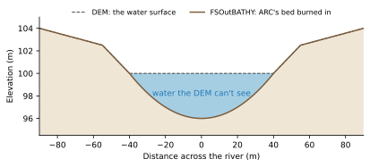

# Bathymetry

A DEM usually shows the water surface, not the channel bed beneath it. ARC can estimate the missing channel and write
its bed elevations to a raster (`BATHY_Out_File`; see ARC's
[Bathymetry](https://automated-rating-curve.readthedocs.io/en/latest/bathymetry/) page). Curve2Flood burns that raster
into the DEM and writes the result to `FSOutBATHY`, a DEM that later ARC and Curve2Flood runs can use. Give both keys
to turn this on.

## The steps

1. **ARC's bed.** The cells where ARC's raster has a value take ARC's bed elevation, as ARC wrote it.
2. **Everywhere else**, the DEM is used as it is.
3. **Banks.** Unless `Bathy_Use_Banks`, the result is never above the DEM, so the bathymetry only ever lowers it.

ARC has already decided where the channel goes, from its banks (the edge of `BathyWaterMask`'s water, when ARC is given
one), and filled the small gaps between its cross sections. So the burned DEM is what ARC's rating curves were worked
out on: each stream cell of the VDT database holds its `Elev`, and the channel keeps the banks its cross sections were
carved with. Making the bathymetry needs no flows and no flood map.
