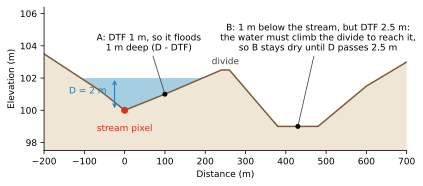
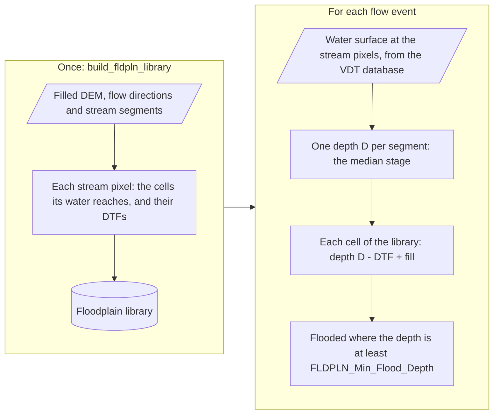

# FLDPLN Mapper

`mapper: Curve2Flood-FLDPLNpy`. FLDPLN (Kastens, 2008) works out ahead of time which cells the water at each stream
pixel can reach, and how deep the water at the stream pixel must be to get there: the cell's **depth to flood**
(DTF). Mapping a flood then only needs the water depth of each stretch of stream. The water follows the terrain: it fills the
land upstream of a stream pixel against the flow directions (backfill), spills over low divides into the next valley
(spillover), and fills depressions to the level of their rim.



A cell's DTF is the climb the water must make to reach it, not its height above the stream: B is lower than the
stream, but the water must first rise 2.5 m to cross the divide.

The DTFs are measured on a DEM with its depressions filled, so water can always flow downhill to the stream. They are
saved in a **floodplain library**, built once for a DEM and stream network, with a row for each pair of a stream pixel
(the flood source pixel, `FSP`) and a cell it can flood (the floodplain pixel, `FPP`), its `DTF`, the `segment` of
stream the source pixel belongs to, and the cell's `fill`: how far the filled DEM sits above the DEM there, as in a
filled pit or a burned channel.

A segment's stream pixels all start at the same depth, so each cell keeps the one pixel of the segment that reaches it
at the smallest depth. The library is therefore exact for **one water depth per segment**. One depth suits a short stretch of river better than a
long one, so reaches are first cut where the filled DEM under the stream bends or steps by more than
`max_profile_deviation` (1 m), and into pieces no longer than `max_reach_length` (5 km).

The library is built once; each flow event is then mapped from it:



## Inputs

All on the DEM's grid:

- **`Flow_Direction_File`**: D8 flow directions from the filled DEM, with the WhiteboxTools codes for the neighbour
  each cell drains to:

    | | | |
    | --- | --- | --- |
    | 64 (north-west) | 128 (north) | 1 (north-east) |
    | 32 (west) | cell | 2 (east) |
    | 16 (south-west) | 8 (south) | 4 (south-east) |

- **`Stream_Info_File`**: a table of the stream segments, one row each, with the columns `start_pixel` (the segment's
  most upstream pixel), `end_pixel` (its last), `length` (its number of pixels along the flow directions) and
  `stream_id` (its reach ID). Pixels are numbered row by row: $\text{row} \times \text{columns} + \text{column}$.
- **`Print_VDT_Database`**: the rating curves.
- **`FLDPLN_Library`**: the floodplain library.

A Parquet library records the grid its pixels are numbered on (its rows, columns, geotransform and coordinate
system), its cells' size in metres and how it was built, in its metadata (`library_metadata`). So `DEM_File` is
needed only for `OutWSE` or the bathymetry; without it the flood map takes the library's
grid, or, for a library built before it said, the flow directions'. Every raster given must be on that grid, or the
run stops.

## Building the library

```python
from curve2flood import build_fldpln_library

build_fldpln_library(
    dem="dem_with_bathymetry.tif",  # the DEM floods are mapped on
    filled_dem="filled.tif",
    stream_info_file="stream_info.parquet",
    flow_direction_file="flowdir.tif",
    library_file="fldpln_library.parquet",
    dh=0.5,                    # depth step (m) of the default solver="iterative"
    fldmn=0.1,                 # least depth (m) a flooded pixel counts as when a spill stops
    fldmx=25,                  # deepest flood considered (m)
    iterative_spill=False,     # spill over a divide once per step (coarse DEMs)
    vdt_file="vdt.parquet",    # optional
)
```

`dh`, `fldmn`, `fldmx` and `iterative_spill` default to the values shown.

DTFs are stored as found, from 0 at the stream pixel itself. The University of Kansas FLDPLN raises a DTF below
`fldmn` to `fldmn`, which maps every stream pixel, and every cell of a flat channel bed, `fldmn` too shallow. `fldmn` still sets the least depth the iterative solver counts a flooded pixel as when
it decides where a spill stops.

- **Solvers.** `solver="iterative"` (the default) raises the water `dh` at a time, as the original FLDPLN does. Without
  `iterative_spill`, water that spills over a divide is followed once per step; a larger `dh` holds back spillover more. `solver="exact"` finds each cell's DTF as the smallest total
  climb along any path from the stream, where going downhill costs nothing: the iterative solver with
  `iterative_spill` as `dh` goes to 0. Its water keeps running downhill for as long as it can, so a stream at the
  head of a valley floor or fan floods everything lower. 
- **`vdt_file`.** With the VDT database, each segment floods only as deep as its rating curves go (at most `fldmx`),
  and segments without rating curves are left out.
- **`dem`.** The DEM the floods are mapped on, with the bathymetry if there is one. The library's `fill` comes from it,
  so rebuild the library when it changes. Its no-data cells never flood and are left out.
- **`spill_decay`.** Head (m) water spilling over a divide loses per pixel down its path: a minimum slope of its water
  surface. The path's `j`-th pixel floods from `j * spill_decay` more DTF than its first, it backfills with that much
  less water, and the path ends where the water runs out. Without it a spill keeps its whole depth however far it
  runs, so on flat ground it floods everything below its source's water surface as a level pool. The exact solver
  takes it off the water's head on every step down, to lower ground whichever way or along the flow directions, as a
  spill loses it down its path (and from the first step down, which the depth-stepped spill takes for free). 
- **`max_reach_length`.** Reaches longer than this (m) are cut into `ceil(length / max_reach_length)` segments of
  about equal length, each solved and flooded on its own. The length is measured along the flow directions with the
  filled DEM's cell size. 5000 m by default; None keeps every reach whole. 
- **`max_profile_deviation`.** Also cuts each reach where the filled DEM under the stream bends or steps, before
  `max_reach_length` cuts the pieces. The profile of the filled DEM along the river is simplified top-down
  (Douglas–Peucker): a piece is split at its stream pixel farthest above or below the straight line between its ends,
  until no pixel is more than this many metres off its line. A pixel at a bend goes with the gentler of its two
  pieces, so a step from one pixel to the next is a cut between them. One depth per segment fits a straight bed best,
  because the stage (water surface minus the filled DEM) jumps at a step and where a filled flat begins. 1 m by
  default; None makes no such cuts. 
- **`max_cells_per_segment`.** Caps the rows one segment may add. A segment that would flood more stops at the depth
  where it fills up, so the largest floods on flat ground are mapped only that far. This trades accuracy for memory.
  Exact solver only.
- **`bg_mask`.** Cells to not flood, such as lakes.
- **`water_mask`.** The river's water, such as the bathymetry water mask (`BathyWaterMask`): an array on the DEM's
  grid, positive for water. FLDPLN keeps each segment $R$'s water out of $TD(R)$, the stream below the segment's end,
  so that the stream below floods the land downstream instead. On its own, $TD(R)$ is only the stream line, a pixel
  wide. The segment's water runs down the channel beside that line, past
  the segment's end, and floods everything downstream that the channel reaches. With the water mask, $TD(R)$ also takes
  every water cell whose flow path first meets the stream network inside it: the channel below the segment, but not
  its tributaries, whose water first meets their own streams. None keeps the line alone.
- **`parallel`.** Solves several segments at once, in threads that share the rasters; `processes` sets how many (the
  CPU count, at most 4, by default). Each thread keeps its own copy of the solver's arrays (see below), and the
  library is written by one thread, which soon sets the pace.

A Parquet library (`.parquet` or `.pq`) is much smaller than a CSV one. Libraries saved either way
map the same.

Each segment's rows are written to the library as soon as the segment is solved, sorted by `FSP` and then `FPP`, so
the build holds only a few segments' rows at a time, however big the library grows. A flat floodplain makes a very big
library. 

## Mapping a flood

For each flow event:

1. **Water at the stream.** Each stream cell's water surface elevation comes from the VDT database at the reach's flow
   (see [Rating curves](key_concepts.md#rating-curves)).
2. **Stage.** Each reach's stream pixels are walked down the flow directions from its `start_pixel`, `length`
   pixels. At each stream pixel with a rating curve, the water depth over the filled DEM, its stage, is the rating
   curve's water surface minus the filled DEM. The filled DEM there is the rating curve's `Elev` (the DEM under the
   pixel, the bed ARC measures its depths from) plus the library's `fill` of the pixel's own cell. A pixel whose own cell isn't in the library counts as having no rating curve. 
3. **One depth per segment.** Each segment $R$ floods at a single depth $D(R)$: the median of its stream pixels'
   stages (the lower of the two middle stages for an even count, so always a stage of the
   segment).

    In a segment where some pixels have rating curves, a pixel without one takes the stage interpolated linearly
    between the segment's own pixels with one (held beyond the first and last), so $D(R)$ never leaves the range of
    the stages ARC gave the segment. The depth is interpolated, not the water surface: where ARC has no rating curve,
    as down a cliff, the bed bends between the pixels that have one, and a straight water surface across the gap would
    stand metres above it (or below it). Interpolated from the next segment, such pixels would pull the median toward
    that segment's stage. A segment with no rating curve at all floods nothing.
4. **Depth.** Each library row gives its floodplain cell $p$ a depth from its segment $R$:

    $$
    \text{depth}(p) = \max \big( D(R) - \text{DTF}(s, p) + \max(\text{fill}(p), 0) \big)
    $$

    over the rows whose water reaches $p$'s filled surface, $D(R) - \text{DTF}(s, p) > 0$.
    $D - \text{DTF}$ is the water above the filled DEM, and the fill adds the depth below it, in a filled pit or a
    burned channel. Water that doesn't reach a filled pit's rim never spills into it, however deep the pit.

    The bathymetry can also raise the DEM above the filled DEM, where ARC's bank-referenced bed sits higher than the
    DEM: the fill is then negative. The library was routed across the filled surface, through the raised cell, so the
    water covers it wherever it reaches that surface: such a fill counts as 0, and the depth and the water surface
    (`OutWSE`) are measured from the filled DEM.
5. **Flood.** A cell floods where its depth is at least `FLDPLN_Min_Flood_Depth` (1 cm by default) and above 0.

## Speed and memory

Curve2Flood's iterative solver gives the same library as the University of Kansas's MATLAB model,
`fldpln_model_v5ram.m` (see [Development](development.md#tests)), and so does `tests/fldpln_model_v5ram.py`, a
line-for-line Python port of the MATLAB model. Here the three build the same rows for the same segments:

--8<-- "benchmarks/fldpln_matlab/results.md"

Each ran in a new process, warmed up on one short segment first, so neither starting MATLAB or Python nor compiling
is timed. Memory used is the most each process held while it warmed up and built the segments, less what it held
once it had loaded its inputs; the peak also counts what MATLAB or Python itself takes. To run the benchmark again
(it needs MATLAB on the `PATH`, and takes about a quarter of an hour):

```bash
python benchmarks/fldpln_matlab/run_benchmark.py
```

It checks that every implementation gives the MATLAB model's rows, and rewrites the table above
(`benchmarks/fldpln_matlab/results.md`, with every figure in `results.json`).

## Reference

Kastens, J. H. (2008). *Some New Developments on Two Separate Topics: Statistical Cross Validation and Floodplain
Mapping*. PhD dissertation, University of Kansas.
