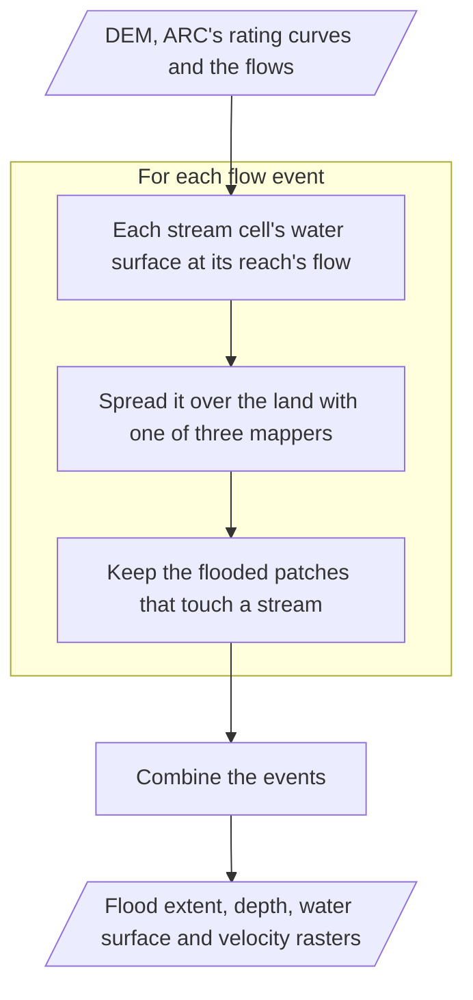

# Curve2Flood

Curve2Flood turns river flows into flood maps. [ARC](https://automated-rating-curve.readthedocs.io/en/latest/) builds
a rating curve for every stream cell of a DEM. Curve2Flood looks up each stream cell's water surface for a flow and spreads it over the land. It writes
rasters of the flood's extent, depth, water surface elevation, and velocity. It can burn ARC's channel bathymetry
into the DEM.

For each flow event, Curve2Flood:

1. Reads each reach's flow from the flow file.
2. Finds each stream cell's water surface elevation and top width at that flow, from ARC's VDT database or curve file.
3. Spreads the water from the stream cells over the land, with one of three mappers: kernel weighted, multi-point
   interpolation or FLDPLN.
4. Removes flooded patches that don't touch a stream.

It then combines the events and writes the outputs the input file asks for.

## Authors

Mike Follum leads the project. Other contributors include Joseph Gutenson and L. Ricardo Rosas.
